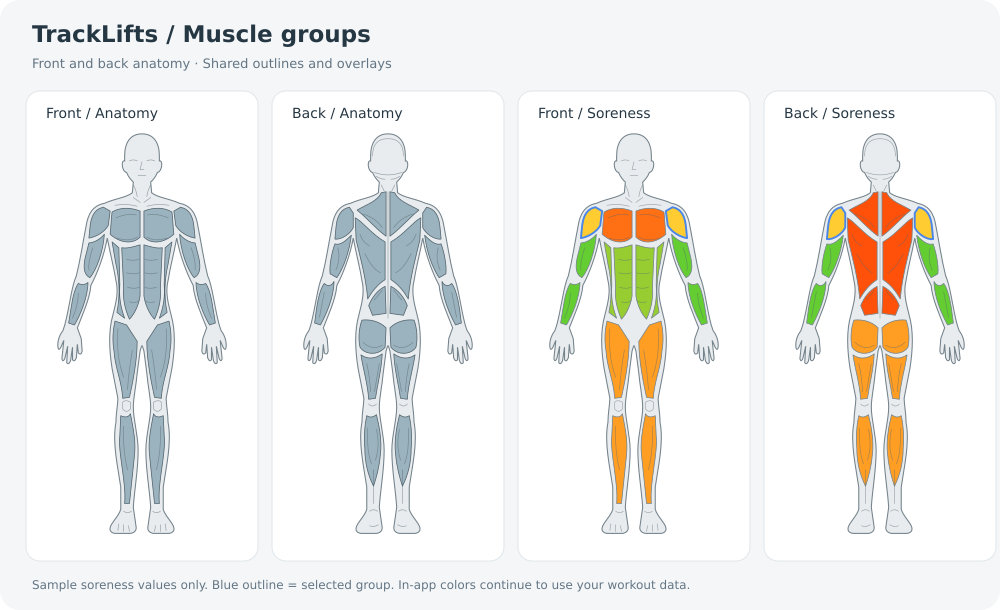

# Profile muscle group artwork

Original vector artwork for the active Profile soreness diagram. All layers use
`viewBox="0 0 200 430"`, so the front and back share the same position and scale.



## Files and editing

- `anatomy.json` is the **source of truth** used directly by `BodyDiagram.tsx`.
  Paths describe the left half; the renderer reflects them about x=100. Body
  fills close at the center; their outlines stay open to avoid a visible seam.
- `front-body.svg` / `back-body.svg`: neutral silhouette and contour details.
- `{view}-{group}.svg`: transparent, independently colorable overlays. Set
  `color` to control their `currentColor` fill. Layer them in the shared viewBox.
- `{view}-muscle-groups.svg`: assembled neutral illustrations for design tools.
- `preview.svg` / `preview.png`: design review sheet with **sample** soreness
  values and selected shoulders; these are not app data or an app screenshot.

After editing the JSON, regenerate the portable assets:

```sh
node scripts/generate-muscle-svgs.cjs
```

The review sheet is a snapshot; refresh it when changing the artwork.

## Group mapping

| View | Groups |
| --- | --- |
| Front | Chest, shoulders, arms (including forearms), core, legs |
| Back | Back, shoulders, arms (including forearms), legs (including glutes) |

The divisions and interior lines are illustrative contours, not additional
soreness measurements. Every region in a group receives that group's existing
score. Rear lower-back regions belong to Back, matching the existing selector;
Chest and Core remain front-only.

## Profile integration

`components/Profile/MuscleSoreness/BodyDiagram.tsx` renders the JSON paths using
`react-native-svg`. Soreness calculations, group buttons, and the information
panel are unchanged. Selected regions retain a blue outline. Neutral body and
contour strokes adapt to light/dark mode.

The SVG is 100% of the existing body column's content width, with the original
400px height and `xMidYMid meet`. The existing 50% body / 45% information columns
and 15px body padding remain intact. On narrow phones the figure scales down
inside that slot instead of the old 300px fixed SVG overflowing the column.

The older SVG files one directory up and `MuscleSorenessNEW.tsx` are legacy
experiments; the active profile imports `MuscleSoreness.tsx`.
